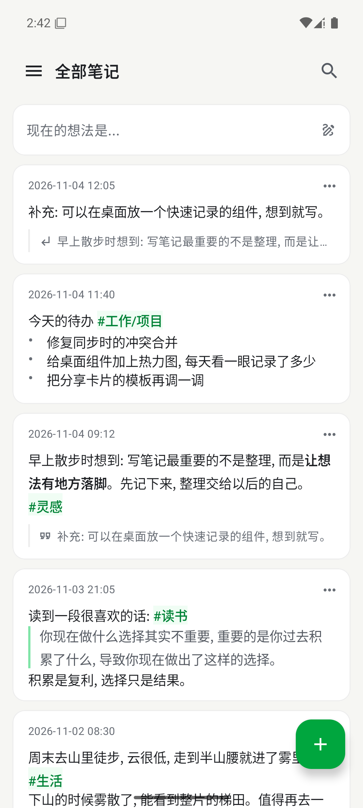
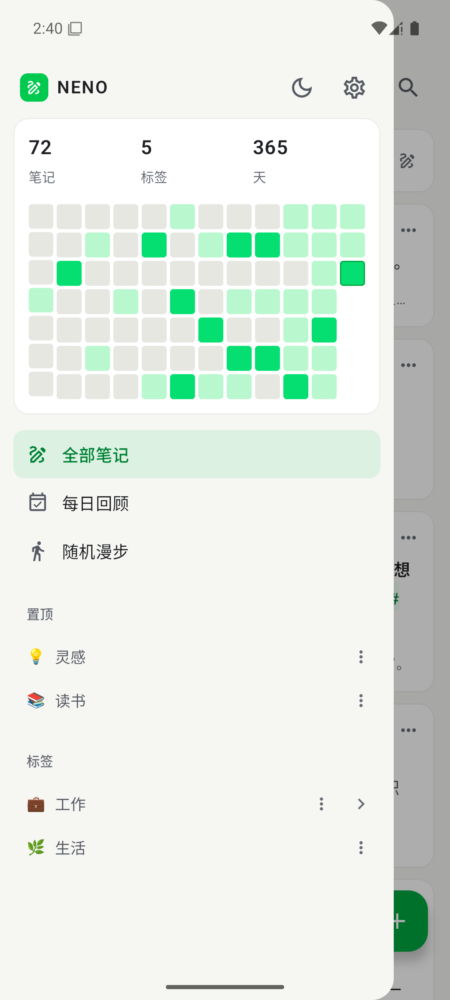
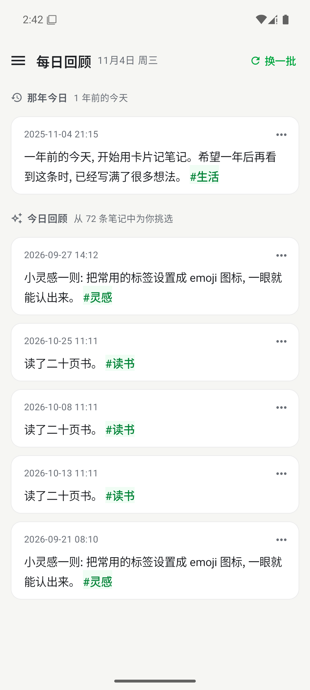
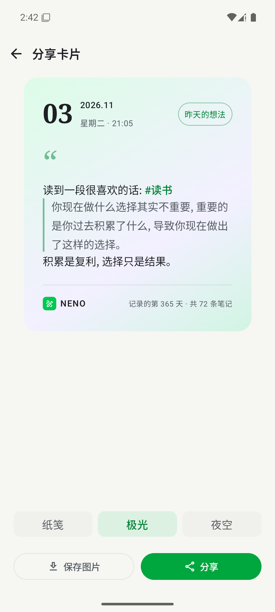
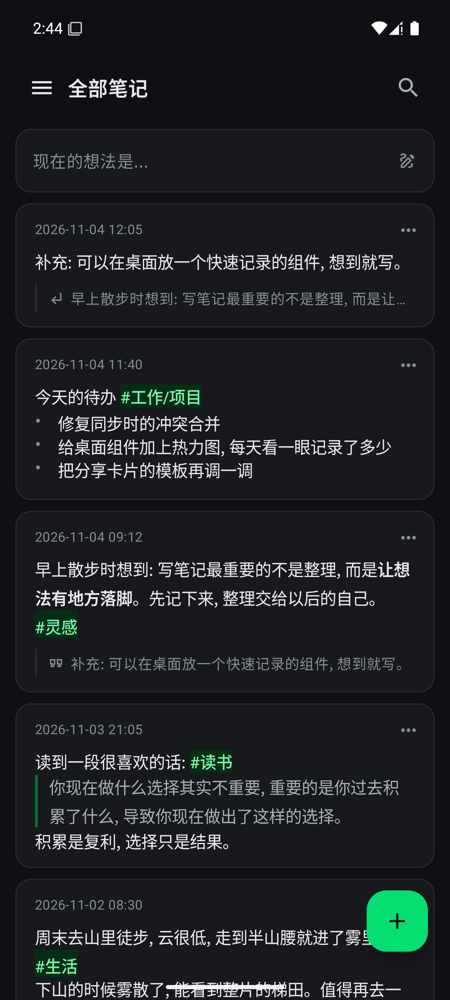
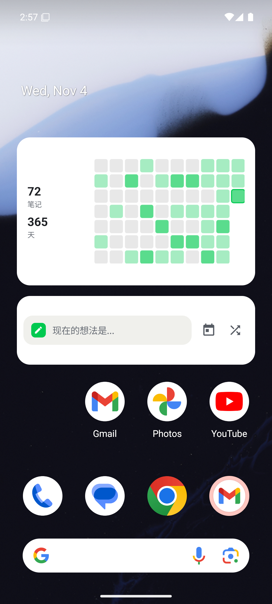
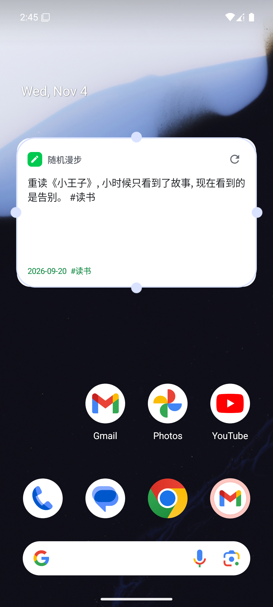

<div align="center">

# NENO for Android

**记下此刻, 与未来的自己重逢**

开源卡片笔记应用 [NENO](https://github.com/openneno/neno) 的安卓客户端。<br/>
没有服务器, 笔记保存在你自己的 GitHub 仓库里, 与网页端、浏览器插件实时互通。

[](https://github.com/openneno/neno-mobile/releases/latest)
[](https://github.com/openneno/neno-mobile/actions/workflows/release.yml)


[](LICENSE)

[**下载最新版**](https://github.com/openneno/neno-mobile/releases/latest) · [网页版](https://neno.pages.dev/) · [浏览器插件](https://github.com/openneno/neno-chrome-plugin)

</div>

<p align="center">
  
  
  
  
  
</p>

## ✨ 特点

| | |
| --- | --- |
| 📝 **随手记录** | 富文本编辑(加粗、斜体、列表、链接), 输入 `#` 自动补全标签, 标签实时高亮, 一次添加多张图片, 给笔记写批注 |
| 🏷️ **标签整理** | 多级标签 `#工作/项目`, 置顶常用标签, 给标签换上 emoji 图标, 一键重命名 |
| 🔍 **找回想法** | 按标签、日期、关键词筛选; 在热力图上点一下, 就能看到那天写了什么 |
| 📅 **回顾** | 每日回顾(与网页端同一天看到同一批笔记)、那年今日、随机漫步 |
| 🖼️ **分享卡片** | 纸笺、极光、夜空三种模板, 保存到相册或直接分享; 也能从任何应用把文字分享到 NENO |
| 🔄 **多端同步** | 与网页端共用一个 GitHub 仓库: 增量拉取、按笔记合并、一次提交推送; 前台近实时, 后台自动补推 |
| 🎨 **好看** | "安静的纸" 设计, 浅色 / 深色 / 跟随系统, 6 种主题色, 排版与网页端一致 |
| 💾 **数据在你手里** | 笔记就是仓库里的 JSON 文件; 备份文件与网页端通用 |

## 🧩 桌面组件

<p align="center">
  
  
</p>

| 组件 | 尺寸 | 说明 |
| --- | --- | --- |
| **快速记录** | 4×1 | 点一下就能写; 宽度足够时附带每日回顾、随机漫步入口 |
| **随机漫步** | 4×2 | 在桌面与一条过去的笔记重逢, 点刷新换一条; 遇到往年今天的笔记会显示 "那年今日" |
| **记录热力图** | 4×2 | 笔记数、记录天数和最近几周的热力图, 自动适应组件大小 |

组件跟随应用的主题色, 写笔记或同步后自动刷新。

## 🚀 开始使用

1. 从 [Releases](https://github.com/openneno/neno-mobile/releases/latest) 下载 APK 安装(需要 Android 8.0+)
2. 打开 **设置 → 同步**:
   - **第一次使用**: 点击 "生成 GitHub Token"(已预选所需权限), 粘贴后选择已有仓库, 或新建私有仓库 `neno-data`
   - **已经在用网页端**: 扫描网页端设置页的二维码, 或粘贴 neno token / 同步链接
3. 开始记录。没有网络时照常使用, 联网后自动同步

> 二维码、同步链接和 neno token 中包含你的 GitHub Token, 请不要分享给他人。

## 🔗 与网页端互通

安卓端与 [网页端](https://github.com/openneno/neno) 使用完全相同的仓库结构, 两端可以同时使用:

```
YYYY-MM-DD/<笔记 id>.json   一条笔记
picData/<图片 id>.<后缀>     一张图片
pinTags/pinTags.json        标签设置(置顶标签、标签图标)
```

同步引擎移植自网页端的 `syncEngine.js`。两端通过 git blob sha 判断文件是否变化,
所以笔记文件的序列化与网页端的 `JSON.stringify(note, null, "\t")` 逐字节相同, 并保留其他工具写入的字段。
[`CompatTest`](app/src/test/java/com/openneno/neno/CompatTest.kt) 用网页端代码生成的数据校验了这一点。

## 🛠️ 构建

需要 JDK 17+ 和 Android SDK 36。

```bash
./gradlew assembleDebug          # app/build/outputs/apk/debug/app-debug.apk
./gradlew testDebugUnitTest      # 单元测试
./gradlew assembleRelease        # 本地没有发布签名时使用 debug 签名
```

### 自动发布

`main` 分支每次提交(只改文档时除外), [Release](.github/workflows/release.yml) 工作流会运行测试、构建签名的 APK,
并发布 `v1.0.<序号>` 版本, 更新内容取自提交记录。Pull Request 由 [CI](.github/workflows/ci.yml) 检查。

发布签名通过仓库 Secrets 提供:

| Secret | 说明 |
| --- | --- |
| `NENO_KEYSTORE_BASE64` | keystore 文件的 base64 |
| `NENO_KEYSTORE_PASSWORD` | keystore 密码 |
| `NENO_KEY_ALIAS` | key 别名 |
| `NENO_KEY_PASSWORD` | key 密码 |

所有版本必须用同一个 keystore 签名, 否则用户无法覆盖安装新版本。

## 🧱 技术栈

Kotlin · Jetpack Compose · Material 3 · [Glance](https://developer.android.com/develop/ui/compose/glance) · WorkManager · OkHttp · [Compose Rich Editor](https://github.com/MohamedRejeb/compose-rich-editor) · jsoup · Coil · ZXing

## 🌱 NENO 家族

| 项目 | 说明 |
| --- | --- |
| [neno](https://github.com/openneno/neno) | 网页端 / PWA |
| [neno-chrome-plugin](https://github.com/openneno/neno-chrome-plugin) | 浏览器插件, 选中网页文字一键保存 |
| [neno-cli](https://github.com/openneno/neno-cli) | 在命令行中记录 |
| [neno-tg](https://github.com/openneno/neno-tg) | Telegram Bot |

## 📄 License

[GPL-3.0](LICENSE)
